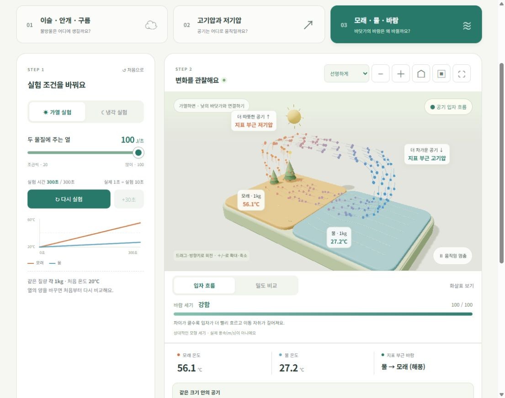
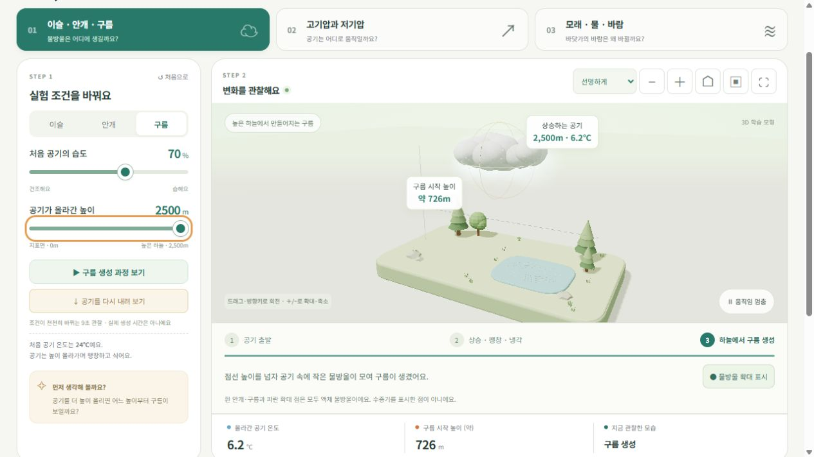

# 날씨 연구소 · Weather Lab

**손끝으로 만나는 3D 과학 실험실**

초등학교 5학년의 「날씨와 우리 생활」 학습을 돕는 웹 앱입니다. 온도·습도·기압·열의 양을 직접 바꾸면서 날씨 현상을 관찰하고, 발견한 내용을 관찰 노트에 남길 수 있습니다.

HTML, CSS, JavaScript와 Three.js로 만든 정적 사이트이며, 로그인이나 외부 API 키 없이 실행됩니다.



## 실험 소개

| 실험 | 바꿀 수 있는 조건 | 관찰할 내용 |
| --- | --- | --- |
| 이슬 · 안개 · 구름 | 처음 습도, 잎·공기의 온도, 공기가 올라간 높이 | 응결이 시작되는 조건과 물방울이 생기는 위치 |
| 고기압과 저기압 | 두 지역의 기압과 온도 | 기압 차에 따른 흐름, 같은 부피에서의 공기 밀도와 입자 운동 |
| 모래 · 물 · 바람 | 가열·냉각, 같은 시간 동안 주고받는 열의 양 | 비열에 따른 온도 변화, 해풍·육풍의 개념 |

## 주요 기능

- 3D 모형 회전·확대·축소, 정면·기본 시점, 전체 화면
- 이슬·안개·구름의 생성과 사라짐을 단계별로 보여 주는 9초 재생
- 공기 입자 흐름과 밀도 비교, 표시 차이 강조, 방향 화살표
- 모래와 물의 온도 변화 그래프와 상대적인 바람 세기 표시
- 관찰 기록 최대 40개, 기록별 메모, 한글 CSV 내려받기
- 수업용 선생님 가이드와 계산 모형 설명
- 작은 화면에 맞춘 배치, 키보드 조작, 가벼운 화면 품질 모드

## 빠른 시작

Node.js 24.x와 npm이 있는 환경에서 이 README가 있는 폴더를 열고 실행합니다. 이번 패키지는 Node.js **24.14.0**, npm **11.9.0**에서 검증했습니다.

```sh
npm start
```

브라우저에서 [http://localhost:4173](http://localhost:4173)을 엽니다. 서버 종료는 터미널에서 `Ctrl+C`를 누릅니다.

외부 npm 의존성과 빌드 단계가 없어 `npm install`이 필요하지 않습니다. Three.js와 보조 모듈은 `dist/vendor/`에 포함되어 있습니다. `index.html`을 더블 클릭하는 대신 HTTP 서버를 통해 접속해 주세요.

다른 포트로 실행하려면 PowerShell에서 다음과 같이 설정합니다.

```powershell
$env:PORT = '8080'
npm start
```

3D 화면은 ES 모듈·import map·WebGL 2를 지원하는 브라우저가 필요합니다. Chrome 또는 Edge에서 먼저 확인해 주세요.

## 테스트

```sh
npm test
```

Node.js 내장 테스트 실행기로 물리 계산, 입자 표현, 흐름의 연속성, 응결 장면, 렌더링 시간 처리와 장면 최적화를 확인합니다. 배포 준비 시 기존 테스트 **30개가 모두 통과**했습니다. 자세한 검증 범위는 [개발 문서](docs/DEVELOPMENT.md)를 참고하세요.

## 화면 예시

구름 실험에서는 공기가 올라가면서 식고, 계산한 시작 높이 위에서 물방울이 나타납니다.



## 파일 구조

```text
.
├── README.md
├── THIRD_PARTY_NOTICES.md
├── package.json
├── server.mjs                  # 로컬 확인용 정적 파일 서버
├── .gitignore
├── .gitattributes
├── .github/workflows/pages.yml # 수동 실행하는 GitHub Pages 배포
├── dist/                       # 실행 소스이자 정적 배포 대상
│   ├── index.html
│   ├── style.css
│   ├── app.js
│   ├── physics.mjs
│   ├── air-particles.mjs
│   ├── airflow.mjs
│   ├── motion.mjs
│   ├── condensation-scene.mjs
│   ├── render-runtime.mjs
│   ├── scene-optimization.mjs
│   └── vendor/                 # Three.js r170, 보조 모듈과 라이선스
├── tests/                      # Node.js 테스트 7개 파일
└── docs/                       # 사용·수업·모형·개발·업로드·배포 문서
    └── images/                 # README와 문서의 화면 예시
```

이 프로젝트의 `dist/`에는 직접 수정하는 실제 소스가 들어 있습니다. 일반적인 빌드 산출물처럼 삭제하거나 Git에서 제외하면 앱을 실행할 수 없습니다.

## 문서

| 문서 | 내용 |
| --- | --- |
| [사용 가이드](docs/USER_GUIDE.md) | 실험별 조작, 관찰 기록, 문제 해결 |
| [수업 활용 가이드](docs/TEACHER_GUIDE.md) | 15분 탐구 활동, 발문과 관찰표 |
| [계산 모형과 가정](docs/MODEL.md) | 수식, 단위, 상수, 시각적 강조와 생략한 과정 |
| [개발 문서](docs/DEVELOPMENT.md) | 모듈 구조, 데이터 저장, 수정과 검증 |
| [GitHub 업로드 안내](docs/GITHUB_UPLOAD.md) | 웹 업로드와 Git 명령, 업로드 폴더 사용법 |
| [배포 안내](docs/DEPLOYMENT.md) | GitHub Pages와 일반 정적 호스팅 |

## 기록 저장

관찰 노트와 화면 품질 설정은 현재 브라우저의 `localStorage`에 저장합니다. 앱에는 기록을 서버로 전송하거나 다른 기기로 동기화하는 기능이 없습니다. 사이트 주소·브라우저·기기가 달라지면 기존 기록이 보이지 않을 수 있으므로 보관할 기록은 CSV로 내려받아 주세요.

## 학습 모형의 범위

이 앱은 원리를 비교하기 위한 학습 모형입니다. 물방울과 공기 입자는 관찰하기 쉽게 표현했고, 바람 세기 0~100은 실제 풍속이 아닙니다. 가열·냉각은 각각 같은 초기 조건에서 새로 시작합니다. 구현한 계산과 가정은 [계산 모형 문서](docs/MODEL.md)에 설명되어 있습니다.

## 제3자 구성 요소

Three.js r170과 보조 모듈의 MIT 라이선스는 [THREE-LICENSE.txt](dist/vendor/THREE-LICENSE.txt)에 보존했습니다. 자세한 목록은 [제3자 고지](THIRD_PARTY_NOTICES.md)를 참고하세요. 프로젝트 자체의 라이선스는 아직 지정되어 있지 않습니다.
